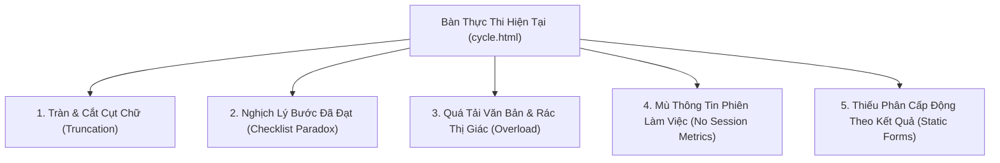

# BẢN NGHIÊN CỨU ĐỐI SÁNH & ĐỀ XUẤT HOẠCH ĐỊNH LẠI GIAO DIỆN BÀN THỰC THI KIỂM THỬ (FASTTRACK STUDIO 2.0)
## Hệ Thống Kiểm Thử & Quản Lý Chất Lượng Phần Mềm (SQTM)

> **Người thực hiện:** Trợ lý AI Antigravity  
> **Thời điểm lập:** 21/10/2026  
> **Mục tiêu:** Khắc phục triệt để các hạn chế về hiển thị chữ, tinh gọn giao diện, hiển thị trực quan kịch bản đã test thành công, bổ sung đo lường tác nghiệp hôm nay/phiên làm việc, áp dụng chuẩn mực thiết kế từ các hệ thống kiểm thử phần mềm hàng đầu thế giới (TestRail, Zephyr Scale, Qase.io, Xray).

---

## 1. PHÂN TÍCH THỰC TRẠNG & CÁC ĐIỂM BẤT CẬP TRÊN GIAO DIỆN HIỆN TẠI

Qua phản ánh từ Người sử dụng và kết quả rà soát chi tiết mã nguồn giao diện `cycle.html`, `tester-cycle.js`, `tester-theme.css`, hệ thống hiện tại đang gặp **5 điểm bất cập lớn**:



### 1.1. Lỗi tràn chữ và cắt cụt văn bản (Text Truncation & Cramped Space)
- **Trên thanh Universal Breadcrumb:** Nhãn đợt kiểm thử bị gán cứng `max-width: 140px; text-overflow: ellipsis`, khiến tên đợt bị cắt thành `🎯 Đợt 1 — Khảo sát Kiế... ▾`.
- **Ở thanh lọc hàng đợi bên trái (`.queue-filter-row`):** Cả 3 thẻ `<select>` (`Tất cả phân hệ`, `Tất cả trạng thái`, `Ưu tiên`) bị ép chung vào 1 hàng ngang rộng 380px. Mỗi ô chỉ còn ~100px khiến chữ bị cắt cụt thành `Tất cả phâ...`, `Tất cả trạn...`, gây ức chế khi đọc.
- **Tiêu đề kịch bản:** Bị giới hạn 2 dòng với `overflow: hidden`, nhiều kịch bản nghiệp vụ dài bị mất ngữ cảnh.

### 1.2. Nghịch lý hiển thị các bước kiểm thử (Step Checklist Paradox)
- **Vấn đề:** Khi mở một kịch bản đã kiểm thử **Đạt (Pass)**, ở phần *"Các bước thực hiện"*, mỗi bước vẫn phơi bày nguyên bộ 3 nút bấm `[Đạt] [Lỗi] [Chặn]` giống hệt như một câu hỏi trắc nghiệm chưa làm.
- **Hệ quả:** Người dùng nhìn vào có cảm giác các bước này chưa được xác nhận hoặc hệ thống đang bắt họ phải bấm chọn lại từng nút một. Đúng ra, khi bài test đã Pass, các bước phải hiển thị trạng thái hoàn thành rõ ràng (ví dụ: biểu tượng tick xanh `✓ Đã đạt` kèm nền xanh dịu), chỉ khi cần sửa đổi mới mở chế độ đánh giá lại.

### 1.3. Quá tải chữ & rác thị giác (Information Overload & Cognitive Friction)
- Toàn bộ màn hình bên phải chia thành **5 khối hộp xếp chồng theo chiều dọc**:
  1. Hộp Tiền điều kiện (`PRECONDITION`) & Hộp Dữ liệu test (`INPUTS`)
  2. Hộp Kết quả kỳ vọng (`EXPECTED RESULTS - ISO 29119-3`) màu xanh lá đậm
  3. Hộp Các bước thực hiện (`Checklist`)
  4. Hộp Kết quả thực tế quan sát được (`ACTUAL RESULT`) với ô textarea rỗng
  5. Hộp Báo cáo lỗi (`Defect Box`) và khung tải ảnh bằng chứng rỗng
- **Hậu quả:** Kể cả khi kịch bản đã `Pass`, giao diện vẫn bắt người dùng cuộn qua một trang dài dằng dặc chứa các ô textarea rỗng và các dòng tiêu đề chữ in hoa to lớn, lặp đi lặp lại. Không gian bị ngột ngạt, không có khoảng thở (white-space) cho mắt.

### 1.4. Mù thông tin phiên làm việc (No Session / Today's Velocity)
- Thống kê hiện tại ở đầu trang (`Bài được giao: 48, Đạt: 24, Lỗi: 9, Chưa chạy: 15`) là **số liệu tổng tích lũy của toàn bộ đợt kiểm thử** qua nhiều ngày/tuần.
- Tester hoàn toàn không biết:
  - *Hôm nay mình đã thực hiện được bao nhiêu bài?*
  - *Trong phiên đăng nhập này mình đã test được bao nhiêu kịch bản, bao nhiêu Pass, bao nhiêu Fail?*
  - *Năng suất làm việc hôm nay đang ở mức nào? Bài nào vừa được mình bấm xong?*

---

## 2. NGHIÊN CỨU ĐỐI SÁNH VỚI CÁC HỆ THỐNG KIỂM THỬ LỚN NHẤT THẾ GIỚI

Để xây dựng một Bàn thực thi kiểm thử đẳng cấp quốc tế, chúng ta nghiên cứu các giải pháp thiết kế từ 4 nền tảng quản trị kiểm thử dẫn đầu toàn cầu:

| Tiêu chí so sánh | TestRail (FastTrack Workstation) | Zephyr Scale (SmartBear Execution Player) | Qase.io (Distraction-Free Runner) | Đề xuất cho Hệ thống của chúng ta |
| :--- | :--- | :--- | :--- | :--- |
| **Bố cục màn hình** | 3 phân vùng dọc: Queue tinh gọn $\to$ Workstation tập trung $\to$ Instant Result Action Bar | Dual-pane: Step list bên trái, Execution Details & Defect logger bên phải | Single/Dual runner: Giao diện tối giản, tập trung 100% vào bước chạy | **Dual-Pane Tinh Gọn:** Queue thông minh + Console tập trung không cuộn trang |
| **Cách hiển thị bước đã Pass** | Checkbox xanh `✓ Passed` kèm thanh tiến độ bước. Không hiển thị các nút chọn phân vân | Dấu tick tròn xanh `✓ Completed`. Ẩn các nút hành động trừ khi Tester bấm vào để Re-test bước | Icon trạng thái `Passed` kèm thời gian thực thi của bước. Giao diện cực thoáng | **Trạng thái Hoàn thành `✓ Đã đạt`** thanh lịch. Chỉ mở tùy chọn đánh giá khi bấm Re-test |
| **Ghép bước & Kết quả kỳ vọng** | Ghép từng cặp: Bước thực hiện $\to$ Kết quả mong đợi ngay bên cạnh | Bảng lưới 3 cột: Bước - Dữ liệu - Kết quả kỳ vọng | Bước và Kết quả kỳ vọng liền khối (Inline Expected) | **Ghép đôi Inline:** Mỗi bước đi kèm kết quả kỳ vọng tương ứng, không tách 2 thẻ |
| **Xử lý Form khi Pass vs Fail** | Khi Pass: Ẩn form lỗi, bấm P là nhảy bài tiếp. Khi Fail: Mở popup log bug | Khi Pass: Form bug ẩn. Khi Fail: Form bug trượt mở với Issue Tracker | Form lỗi chỉ xuất hiện khi ấn Fail/Blocked, không chiếm chỗ màn hình | **Smart Dynamic Accordion:** Pass $\to$ Ẩn form rỗng; Fail $\to$ Tự mở form lỗi & vùng dán ảnh |
| **Đo lường Hôm nay / Phiên làm việc** | Có thanh `Today's Progress` đếm số test run trong ngày | Có widget `Session Results` & nhật ký hoạt động cá nhân | Có bộ đếm `Session: X/Y completed today` kèm tốc độ bài/giờ | **Bộ đếm Tác quyền Hôm nay:** Thống kê trực tiếp số bài đã test trong phiên và hôm nay |

---

## 3. BẢN ĐỀ XUẤT HOẠCH ĐỊNH LẠI GIAO DIỆN: FASTTRACK STUDIO 2.0

### 3.1. Bố cục tổng thể (Clean Layout Architecture)

```
┌────────────────────────────────────────────────────────────────────────────────────────────────────────┐
│ HEADER: SQTM Tester Workspace | 🌐 Danh mục ➔ 🏢 SmartVMS ➔ 📦 v2.0 ➔ 🎯 Đợt 1 (CYC-01) ▾             │
├────────────────────────────────────────────────────────────────────────────────────────────────────────┤
│ SESSION BANNER (Tác quyền hôm nay & Tiến độ đợt):                                                      │
│ 🎯 Đợt 1 — Khảo sát E2E [v2.0]  │ ⚡ HÔM NAY BẠN ĐÃ TEST: 12 bài (9 Đạt • 3 Lỗi) • Năng suất: 8 bài/h   │
│ Tiến độ đợt: 36/48 bài (75%) [████████████████░░░░] 27 Pass | 9 Fail | 0 Block | 12 Còn lại             │
├────────────────────────────────────────┬───────────────────────────────────────────────────────────────┤
│ HÀNG ĐỢI KIỂM THỬ (QUEUE) - 360px      │ BÀN THỰC THI CHÍNH (CONSOLE WORKSTATION) - Tự do, Thoáng đãng │
│ 🔍 [Tìm kiếm mã, tên kịch bản...     ] │                                                               │
│ [Tất cả] [Chưa test] [Hôm nay] [Re-test│ [TC-AUTH-003]  P1 Critical • Phân hệ: M01 Xác thực   ⏱️ 00:35  │
│                                        │ Tiêu đề: Chặn đăng nhập khi nhập mã cán bộ không tồn tại      │
│ ┌────────────────────────────────────┐ │ ───────────────────────────────────────────────────────────── │
│ │✓ [TC-AUTH-001]  Đạt (Hôm nay 10:15)│ │ KẾT QUẢ: [ ✅ PASS (P) ]  [ ❌ FAIL (F) ]  [ ⛔ BLOCKED (B) ]  │
│ │● [TC-AUTH-003]  ĐANG TEST          │ ───────────────────────────────────────────────────────────── │
│ │✗ [TC-AUTH-005]  Lỗi (Hôm nay 10:20)│ │ 📌 Tiền điều kiện & Dữ liệu test: (Thanh thẻ nhỏ gọn 1 dòng) │
│ │○ [TC-AUTH-007]  Chưa chạy          │ │ ⚙️ Ở màn hình login staff.html  │  📊 Mã: NV99999 [📋 Chép] │
│ │○ [TC-AUTH-009]  Chưa chạy          │ ───────────────────────────────────────────────────────────── │
│ │... (cuộn êm ái, hiển thị đủ chữ)   │ │ 📋 CÁC BƯỚC THỰC HIỆN & KẾT QUẢ KỲ VỌNG:                     │
│ └────────────────────────────────────┘ │ ┌───────────────────────────────────────────────────────────┐ │
│                                        │ │ ✓ Bước 1: Nhập mã tài khoản "NV99999".                    │ │
│                                        │ │   ↳ Kỳ vọng: Hệ thống nhận diện định dạng hợp lệ.         │ │
│                                        │ │   Trạng thái: [✓ ĐÃ ĐẠT] (Xanh lá)                        │ │
│                                        │ ├───────────────────────────────────────────────────────────┤ │
│                                        │ │ ✓ Bước 2: Nhấp nút "Đăng Nhập".                           │ │
│                                        │ │   ↳ Kỳ vọng: Xuất hiện thông báo đỏ cán bộ không tồn tại. │ │
│                                        │ │   Trạng thái: [✓ ĐÃ ĐẠT] (Xanh lá)                        │ │
│                                        │ └───────────────────────────────────────────────────────────┘ │
│                                        │ (KHI PASS: Màn hình thoáng sạch, không hiện ô trống thừa)     │
│                                        │ (KHI FAIL: Tự mở khối Báo Cáo Lỗi + Vùng Dán Ảnh Ctrl+V)      │
└────────────────────────────────────────┴───────────────────────────────────────────────────────────────┘
```

---

### 3.2. Bốn Trụ Cột Đổi Mới Cốt Lõi

#### Trụ cột 1: Thống kê tác quyền Hôm nay & Phiên làm việc (Session & Today Velocity Tracker)
- **Thanh banner phía trên chia 2 vùng rõ ràng:**
  1. *Tiến độ toàn đợt kiểm thử:* Tổng 48 bài, thanh tiến độ 4 màu chuẩn ISO.
  2. *Thành tích làm việc hôm nay (Today's Progress):*
     - `⚡ Hôm nay bạn đã test: X bài (Y Đạt, Z Lỗi)`.
     - Chỉ số nhịp độ: `Tốc độ: ~N bài/giờ`.
     - Phân loại rõ ràng bài nào test trong phiên hôm nay so với các bài của những ngày trước.
- **Trong danh sách hàng đợi (Queue bên trái):**
  - Bổ sung 4 tab bộ lọc nhanh dạng nút bấm:
    `[Tất cả (48)]` `[Chưa chạy (12)]` `[Đã test hôm nay (15)]` `[Cần re-test (3)]`.
  - Giúp Tester nhấp 1 phát là thấy ngay danh sách những bài mình vừa xử lý trong ngày.

#### Trụ cột 2: Giải quyết dứt điểm nghịch lý hiển thị bước đã test (Step Completion State)
- **Khi Test Case đã có kết quả `PASS`:**
  - Từng bước hiển thị rõ ràng với biểu tượng **Tick tròn xanh lá `✓ Đã đạt`**.
  - Toàn bộ hàng bước có viền xanh lá nhạt dịu nhẹ, thể hiện bước đã hoàn thành xuất sắc.
  - **LOẠI BỎ HOÀN TOÀN** 3 nút bấm phân vân `[Đạt] [Lỗi] [Chặn]` trên từng bước khi xem lại bài đã Pass.
  - Cung cấp nút chuyển đổi: `[🔄 Đánh giá lại từng bước]` nếu Tester muốn thay đổi chi tiết.
- **Ghép đôi Bước thực hiện & Kết quả kỳ vọng:**
  - Thay vì đặt 1 thẻ Kết quả kỳ vọng riêng ở trên và 1 thẻ Các bước ở dưới (khiến người dùng phải đảo mắt liên tục), hệ thống ghép đôi:
    `Bước 1 ➔ Kết quả kỳ vọng của bước 1`.
    `Bước 2 ➔ Kết quả kỳ vọng của bước 2`.
  - Đây là tiêu chuẩn vàng của **ISO/IEC/IEEE 29119-3** và **TestRail**.

#### Trụ cột 3: Giao diện thở (Breathing Space) & Accordion Động Thông Minh
- **Thu gọn Tiền điều kiện & Dữ liệu test:**
  - Chuyển từ 2 thẻ to lớn chiếm diện tích sang một dải thanh mảnh (Compact Strip) tinh tế với nút `[📋 Copy nhanh]`.
- **Ẩn triệt để các khung trống khi bài test PASS:**
  - Khi một bài test là `PASS`: Khung "Kết quả thực tế quan sát được" và khung "Bằng chứng ảnh chụp" được **tự động ẩn** hoặc thu về 1 dòng ghi chú nhỏ. Màn hình thoáng đãng, không cuộn chuột.
  - Khi Tester bấm `FAIL` hoặc `BLOCKED`: Khối Báo cáo lỗi (Defect Logger) trượt mở với đầy đủ: Phân loại lỗi, Mức độ nghiêm trọng, Hành vi thực tế, và vùng dán ảnh `Ctrl + V`.

#### Trụ cột 4: Chữa dứt điểm lỗi tràn chữ & cắt cụt (Zero Truncation Rule)
- **Universal Breadcrumb:** Loại bỏ giới hạn `max-width: 140px`, cho phép hiển thị đủ tên đợt kiểm thử hoặc hiển thị mã đợt ngắn gọn kèm tooltip đầy đủ.
- **Bộ lọc hàng đợi:** Tách thành:
  - Hàng 1: Ô tìm kiếm toàn văn bản (Search mã, tên kịch bản).
  - Hàng 2: Hai hộp chọn rộng rãi `[Tất cả phân hệ ▾]` và `[Trạng thái ▾]`.
  - Hàng 3: 4 Tab lọc nhanh tác quyền (`Tất cả`, `Chưa chạy`, `Hôm nay`, `Cần re-test`).
- **Thẻ kịch bản:** Cho phép tiêu đề hiển thị đầy đủ, không cắt ngang chữ quan trọng.

---

## 4. KẾ HOẠCH TRIỂN KHAI CHI TIẾT

1. **Giai đoạn 1 (Engine đo lường phiên tác quyền & Lưu trữ vết kiểm thử hôm nay):**
   - Bổ sung cơ chế ghi nhận thời gian thực hiện (`testedAt`, `testedToday`, `sessionCount`) trong `state.cycleResults`.
   - Tính toán chỉ số: Số bài test hôm nay, tỷ lệ đạt hôm nay, năng suất cá nhân.
2. **Giai đoạn 2 (Thiết kế lại giao diện bảng điều khiển & hàng đợi):**
   - Tái cấu trúc thanh banner KPI thành Dual Progress Banner (Đợt + Hôm nay).
   - Thiết kế lại bộ lọc hàng đợi với 4 Tab tác quyền nhanh và layout chống cắt chữ.
3. **Giai đoạn 3 (Đổi mới hoàn toàn Bàn thực thi Test Execution Console):**
   - Thiết kế lại Checklist từng bước: Trạng thái `✓ Đã đạt` rõ ràng khi Pass.
   - Ghép cặp Bước thực hiện và Kết quả kỳ vọng chuẩn ISO 29119.
   - Cơ chế trượt mở form lỗi thông minh (Smart Dynamic Form): Pass siêu gọn, Fail chi tiết.
4. **Giai đoạn 4 (Kiểm thử thực tế trên trình duyệt & Tối ưu phím tắt):**
   - Thử nghiệm các phím tắt siêu tốc: `P` (Pass & Next), `F` (Fail), `B` (Blocked), `Ctrl+S` (Save).
   - Kiểm tra hiển thị trên màn hình Full HD 1920x1080 và Laptop 1366x768.

---

*Bản kế hoạch được lập dựa trên các tiêu chuẩn kiểm thử quốc tế ISO/IEC/IEEE 29119 và mô hình vận hành của TestRail, Zephyr Scale, Qase.io.*
