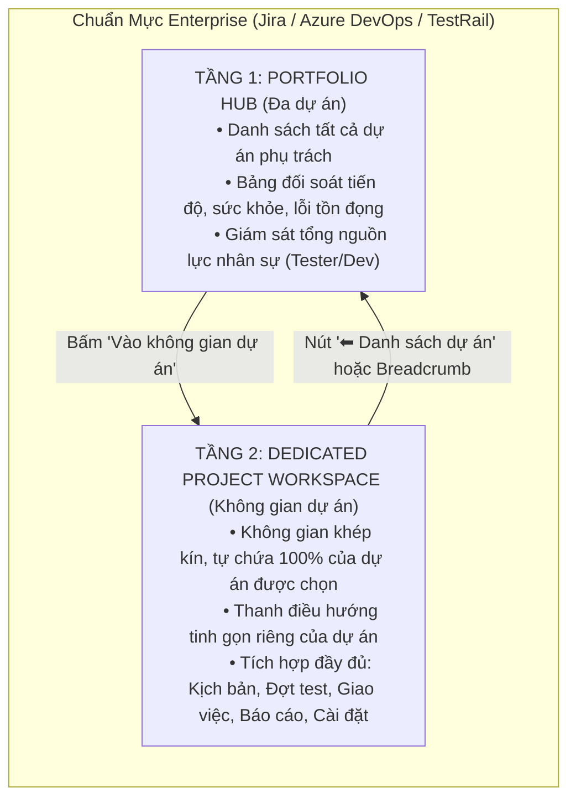
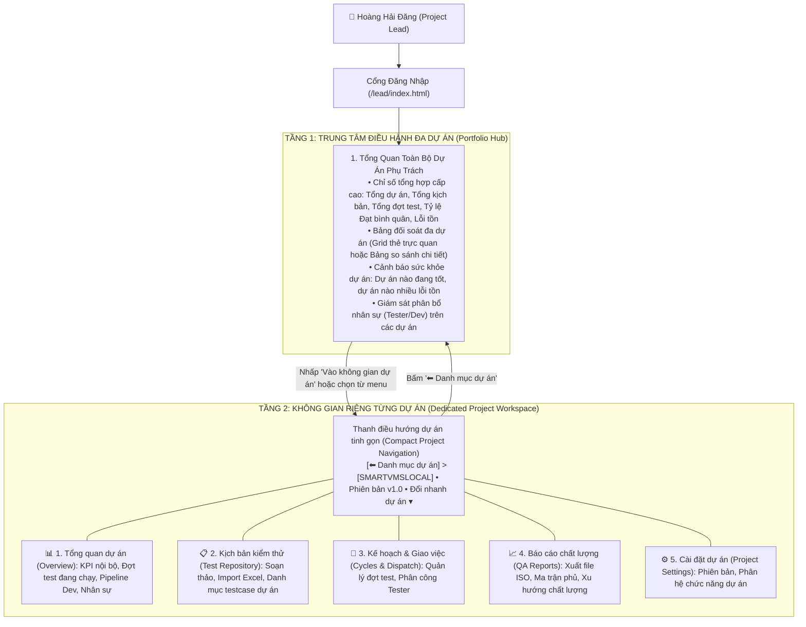

# ĐỀ XUẤT THIẾT KẾ KIẾN TRÚC GIAO DIỆN QUẢN TRỊ VIÊN NHIỀU DỰ ÁN
## Chuẩn Hóa Theo Mô Hình Enterprise (Jira, Azure DevOps, TestRail)

> [!IMPORTANT]
> **Mục tiêu cốt lõi:** Giải quyết triệt để vấn đề bố cục chắp vá hiện tại (nhồi nhét danh sách giao diện con ở đáy trang, hero banner cồng kềnh lặp đi lặp lại che khuất màn hình). Thiết lập kiến trúc phân tầng chuẩn mực quốc tế: **Mỗi dự án có một không gian làm việc riêng biệt (Dedicated Project Workspace) gói gọn toàn bộ nghiệp vụ nội bộ dự án**, tách biệt hoàn toàn với **Trung tâm điều hành danh mục dự án (Multi-Project Portfolio Hub)**.

---

## 1. Phân Tích Thực Trạng & Bất Cập Nghiêm Trọng Hiện Nay

Qua khảo sát thực tế giao diện của tài khoản Quản trị viên dự án (Project Lead) hiện tại, hệ thống đang tồn tại 3 bất cập cấu trúc nghiêm trọng:

### 1.1. Hiện tượng "Giao diện con thừa thãi khi kéo xuống đáy trang" (Quick Action Strip)
- Ở cuối trang `lead/index.html`, xuất hiện một dải 4 thẻ lớn: *Thư viện kịch bản*, *Điều phối & giao việc*, *Báo cáo chất lượng*, *Cài đặt dự án*.
- **Vấn đề:** 4 thẻ này thực chất lặp lại y hệt 4 mục menu đã có sẵn trên thanh Topbar phía trên. Khi người dùng cuộn chuột xuống cuối trang, việc thấy lại một danh sách các "giao diện con" này tạo cảm giác hệ thống bị chắp vá, thiếu cấu trúc không gian làm việc chuyên nghiệp, gây rối mắt và không có giá trị thông tin thực tế.

### 1.2. Hero Banner cồng kềnh lặp đi lặp lại trên mọi trang con
- Khối `lead-project-hero` xuất hiện trên cả 5 trang (`index.html`, `testcases.html`, `assignments.html`, `reports.html`, `settings.html`) với cùng một kích thước rất lớn (chiều cao 160px – 200px).
- **Vấn đề:** Khi cán bộ Lead chuyển sang trang kịch bản hoặc giao việc, họ cần tối đa không gian màn hình để xem bảng dữ liệu và thao tác phân công. Hero banner lặp lại chiếm tới 1/3 màn hình hữu ích, buộc người dùng phải cuộn chuột xuống mới thấy nội dung chính.

### 1.3. Lai tạp, không phân định giữa "Quản trị đa dự án" và "Thực thi 1 dự án cụ thể"
- Khi một Leader phụ trách 2 hoặc nhiều dự án: Màn hình chính hiện nay đang cố gắng nhét cả **thẻ tóm tắt các dự án** ở trên, lẫn **dashboard chi tiết của 1 dự án** ở dưới, rồi lại thêm **dải thẻ con** ở đáy.
- Điều này vi phạm nguyên tắc thiết kế giao diện doanh nghiệp: **Không gian Portfolio (Đa dự án)** và **Không gian Project (Đơn dự án)** phải là hai cấp độ ngữ cảnh rõ ràng, không được trộn lẫn trên cùng một mặt phẳng.

---

## 2. Nghiên Cứu Chuẩn Mực Ngành & Hệ Thống Enterprise Lớn

Khảo sát 4 hệ thống điều hành chất lượng phần mềm và quản trị dự án phổ biến nhất thế giới:



### So sánh cụ thể từng hệ thống:

| Tiêu chí | Jira Software (Atlassian) | Azure DevOps (Microsoft) | TestRail (Idera) | Đề xuất cho SQTM Lead |
| :--- | :--- | :--- | :--- | :--- |
| **Màn hình đăng nhập của Lead** | **Projects Directory / Portfolio**: Danh sách tất cả dự án Lead làm chủ kèm thanh tìm kiếm, bộ lọc trạng thái và sức khỏe. | **Organization Projects View**: Thẻ tóm tắt từng dự án (Work items, Repos, Pipelines, Members). | **Dashboard**: Danh sách các dự án với thanh tiến độ % Milestone và biểu đồ hoạt động gần đây. | **Trung tâm Điều hành Đa Dự Án (Portfolio Hub)**: Toàn bộ dự án Lead được phân bổ, chỉ số tổng hợp toàn danh mục, so sánh sức khỏe/lỗi. |
| **Khi vào một dự án cụ thể** | Chuyển hẳn vào **Project Workspace**: Toàn bộ thanh menu bên trái chỉ phục vụ dự án đó (Summary, Backlog, Board, Reports, Releases, Settings). | Chuyển toàn bộ sang **Project Context**: Sidebar trái gồm Overview, Boards, Repos, Pipelines, Test Plans, Project Settings. | Mở **Project Home**: Tab điều hướng khép kín gồm Overview, Milestones, Test Runs, Test Cases, Reports. | Chuyển sang **Không Gian Dự Án Khép Kín**: Thanh điều hướng tinh gọn 5 phân hệ (Tổng quan, Kịch bản, Giao việc, Báo cáo, Cài đặt). |
| **Cấu trúc Header** | Header tinh gọn, có Breadcrumb `Projects > [Tên dự án]`, có nút chuyển đổi nhanh (Project Switcher). | Header nhỏ gọn thể hiện Icon dự án, Breadcrumb, không có banner to chiếm chỗ. | Header tối giản, tập trung vào không gian làm việc dữ liệu của dự án. | **Header thanh thoát (Compact Project Bar)**: Breadcrumb, Icon mã dự án, Tên dự án, Phiên bản, Dropdown đổi dự án, nút quay lại danh mục. |
| **Xử lý danh sách chức năng con** | Không bao giờ lặp lại danh sách link ở đáy trang; tất cả nằm ở Navigation menu cố định. | Quản lý qua Sidebar hoặc Tab trên cùng. | Quản lý qua Tabs phân hệ rõ ràng. | **Bỏ hoàn toàn dải 4 card ở đáy trang**; các chức năng được quản lý bằng Tabbar/Sidebar chuyên nghiệp. |

---

## 3. Bản Thiết Kế Kiến Trúc Mới Xuất Sắc Cho SQTM Lead

Hệ thống phân chia thành **2 Không Gian Rõ Ràng**:



---

## 4. Chi Tiết Thiết Kế Từng Không Gian

### 4.1. TẦNG 1: Trung Tâm Điều Hành Đa Dự Án (`lead/index.html`)

Đây là màn hình mặc định khi Leader đăng nhập vào hệ thống. Màn hình này tập trung vào bài toán **Quản trị tổng thể nhiều dự án**:

1. **Thanh Topbar hệ thống (Global Topbar)**:
   - Logo thương hiệu + Tên: **Hệ thống kiểm thử & quản lý chất lượng**.
   - Nhãn ngữ cảnh: **Không gian điều hành danh mục dự án**.
   - Đồng hồ thời gian thực, nút đổi giao diện Sáng/Tối.
   - Profile: Avatar **H**, Tên **Hoàng Hải Đăng**, Chức danh **Quản trị viên dự án**, Nút **Thoát**.

2. **Khối Thước Đo Tổng Hợp Danh Mục (Executive Portfolio Metrics)**:
   - Thẻ 1: **Dự án phụ trách** (Ví dụ: `2` dự án đang điều hành).
   - Thẻ 2: **Tổng thư viện kịch bản** (Tổng hợp test case của cả 2 dự án, ví dụ: `1,280` bài).
   - Thẻ 3: **Đợt test đang thực hiện** (Tổng số chu kỳ kiểm thử đang mở trên các dự án, ví dụ: `3` đợt).
   - Thẻ 4: **Tỷ lệ đạt kiểm thử bình quân** (Pass rate toàn danh mục, ví dụ: `88.5%`).
   - Thẻ 5: **Lỗi tồn đọng toàn bộ dự án** (Tổng số bug chưa đóng, cảnh báo mức độ nghiêm trọng).

3. **Lưới Thẻ Dự Án Trực Quan & So Sánh (Project Portfolio Grid)**:
   - Mỗi dự án được thể hiện bằng một thẻ chuyên nghiệp (Card) gồm:
     + Mã dự án (Badge), Tên dự án đầy đủ, Phiên bản hiện hành.
     + **Chỉ số sức khỏe dự án (Health Score)**: Ví dụ `100/100 (🟢 Khởi tạo)` hoặc `85/100 (Ổn định)`.
     + **Tiến độ kiểm thử**: Thanh progress bar thể hiện tỷ lệ Đạt (Xanh lá) / Lỗi (Đỏ) / Chưa test (Xám).
     + **Tóm tắt nguồn lực**: Số bài test, Số đợt test, Số nhân sự được Super Admin phân bổ (Tester, Dev).
     + **Tình trạng lỗi**: Số lỗi New, Dev đang sửa, Reopened.
     + **Nút hành động nổi bật**: `🚀 Vào không gian dự án ➔` (Chuyển ngữ cảnh vào làm việc chi tiết với dự án đó).

4. **Bảng Đối Soát Tổng Thể Chéo Nhiều Dự Án (Cross-Project Comparison Table)**:
   - Cho phép Leader xem dưới dạng bảng danh mục đối soát (tương tự bảng điều hành của Jira):
     + Cột: Mã DA | Tên dự án | Phiên bản | Kịch bản | Đợt test | Nhân sự | Đạt (%) | Lỗi mở | Sức khỏe | Thao tác.
     + Giúp so sánh nhanh dự án nào đang chạy tốt, dự án nào đang có nguy cơ chậm tiến độ hoặc nhiều lỗi tồn đọng.

5. **Giám Sát Phân Bổ Nhân Sự Đa Dự Án (Cross-Project Resource Utilization)**:
   - Biểu đồ/Danh sách thể hiện các nhân sự Tester và Dev trong các dự án của mình:
     + Nhân sự nào đang phụ trách bao nhiêu kịch bản trên từng dự án.
     + Đảm bảo không xảy ra tình trạng một Tester bị quá tải trên nhiều dự án cùng lúc.

---

### 4.2. TẦNG 2: Không Gian Làm Việc Riêng Biệt Cho Từng Dự Án (`lead/project.html`)

Khi Leader bấm vào một dự án bất kỳ, toàn bộ giao diện chuyển sang **Không gian làm việc riêng biệt (Dedicated Project Workspace)** của dự án đó:

```
+-------------------------------------------------------------------------------------------------------+
|  👑 HỆ THỐNG KIỂM THỬ & QUẢN LÝ CHẤT LƯỢNG                                   [🕒 22:15] [🌙] [H Đăng] |
+-------------------------------------------------------------------------------------------------------+
|  [⬅ Danh mục dự án]  >  [🏢 SMARTVMSLOCAL] • Phiên bản: v1.0 • Đang kiểm thử    [Đổi dự án ▾]         |
|  [📊 Tổng quan]  [📋 Kịch bản kiểm thử]  [📌 Kế hoạch & Giao việc]  [📈 Báo cáo]  [⚙️ Cài đặt dự án]   |
+-------------------------------------------------------------------------------------------------------+
|                                                                                                       |
|  NỘI DUNG CHUYÊN BIỆT CỦA PHÂN HỆ ĐANG CHỌN (100% DIỆN TÍCH MÀN HÌNH, KHÔNG BỊ BANNER CHE KHUẤT)     |
|                                                                                                       |
+-------------------------------------------------------------------------------------------------------+
```

1. **Thanh Điều Hướng Dự Án Tinh Gọn (Compact Project Navigation Bar)**:
   - **Nút điều hướng quay lại**: `⬅ Danh mục dự án` (Quay về Tầng 1 ngay lập tức).
   - **Breadcrumb rõ ràng**: `Dự án phụ trách > [Mã dự án] Tên dự án`.
   - **Tag phiên bản & trạng thái**: `Phiên bản: v1.0` • `🟢 Đang triển khai`.
   - **Dropdown đổi nhanh dự án**: Cho phép chuyển thẳng sang dự án khác mà không cần quay lại trang chủ.
   - **5 Tab phân hệ khép kín của dự án**:
     1. 📊 **Tổng quan**: Dashboard KPI, các đợt test đang chạy, pipeline dev sửa lỗi, danh sách nhân sự của dự án này.
     2. 📋 **Kịch bản kiểm thử**: Quản lý thư viện testcase, phân hệ, chức năng, nhập file Excel kịch bản của riêng dự án này.
     3. 📌 **Kế hoạch & Giao việc**: Tạo đợt test (Round 1, Round 2...), ma trận giao việc cho Tester trong dự án này.
     4. 📈 **Báo cáo chất lượng**: Biểu đồ tiến độ, ma trận độ bao phủ, xuất biên bản nghiệm thu chất lượng chuẩn ISO của riêng dự án này.
     5. ⚙️ **Cài đặt dự án**: Quản lý các phiên bản phát hành, danh mục phân hệ của riêng dự án này.

2. **Loại Bỏ Hoàn Toàn Các Yếu Tố Thừa Thãi**:
   - ❌ **Xóa bỏ dải 4 card ở đáy trang**: Không còn danh sách link thừa thãi lặp lại menu.
   - ❌ **Xóa bỏ Hero Banner cồng kềnh**: Thay thế bằng thanh tiêu đề ngữ cảnh nhỏ gọn 44px, giải phóng 100% diện tích màn hình phục vụ thao tác chuyên môn.
   - ❌ **Không nhồi nhét dữ liệu ngoài dự án**: Dữ liệu kịch bản, đợt test, kết quả, thành viên hiển thị trong không gian này 100% thuộc về dự án đang chọn.

---

## 5. Bảng So Sánh Trước & Sau Khi Cải Tiến

| Tiêu chí | Giao diện hiện tại | Giao diện mới chuẩn hóa Enterprise |
| :--- | :--- | :--- |
| **Bố cục tổng thể** | Chắp vá: Vừa có thẻ dự án, vừa có dashboard dự án, vừa có dải card con ở đáy. | Phân tầng rõ ràng: **Tầng 1** là Hub quản trị đa dự án; **Tầng 2** là Không gian làm việc riêng biệt của từng dự án. |
| **Giao diện đáy trang** | Xuất hiện dải 4 card lặp lại các link con dẫn đến các trang khác rất thừa thãi. | Sạch sẽ, liền mạch; người dùng tập trung hoàn toàn vào dữ liệu công việc. |
| **Hero Banner** | Cao 180-200px, lặp lại trên tất cả 5 trang con gây chiếm màn hình. | Thu nhỏ thành Thanh điều hướng ngữ cảnh tinh gọn (Compact Bar cao 48px). |
| **Quản trị đa dự án** | Bị ép xem 1 dự án, khó so sánh tương quan giữa các dự án mình phụ trách. | Có Dashboard tổng hợp toàn bộ các dự án, so sánh tiến độ, sức khỏe và nhân sự dễ dàng. |
| **Chuyển đổi dự án** | Dropdown nhỏ ở góc trên khó thao tác. | Chọn thẻ trực quan dạng Card hoặc chọn từ Dropdown nhanh trên thanh điều hướng. |
| **Ngôn ngữ & Kiểu chữ** | Viết hoa vô tội vạ, chắp vá từ ngữ tiếng Anh. | Thuần Việt 100%, chuẩn chính tả và ngữ pháp tiếng Việt. |

---

## 6. Kế Hoạch Triển Khai Thực Hiện

1. **Bước 1: Nâng cấp `lead/index.html` thành Trung Tâm Điều Hành Đa Dự Án (Portfolio Hub)**:
   - Thiết kế giao diện Dashboard cấp cao với 5 KPI tổng hợp danh mục.
   - Render Lưới thẻ dự án (Project Cards) và Bảng đối soát đa dự án (Cross-project Matrix).
   - Thêm nút hành động chuyển mượt mà vào Tầng 2: `🚀 Vào không gian dự án ➔`.
2. **Bước 2: Chuẩn hóa Tầng 2 thành Không Gian Riêng Biệt Từng Dự Án**:
   - Thay thế toàn bộ Hero banner to đùng trên các trang con bằng `Compact Project Bar` tinh gọn.
   - Xóa bỏ hoàn toàn dải 4 card con ở cuối các trang.
   - Đảm bảo khi ở trong không gian dự án nào, toàn bộ menu (Tổng quan, Kịch bản, Giao việc, Báo cáo, Cài đặt) đồng bộ 100% với dự án đó.
3. **Bước 3: Kiểm thử, đồng bộ & Deploy tự động**:
   - Kiểm tra luồng chuyển đổi giữa Tầng 1 và Tầng 2.
   - Đồng bộ sang thư mục deploy và đẩy lên GitHub/Vercel để nghiệm thu thực tế.
